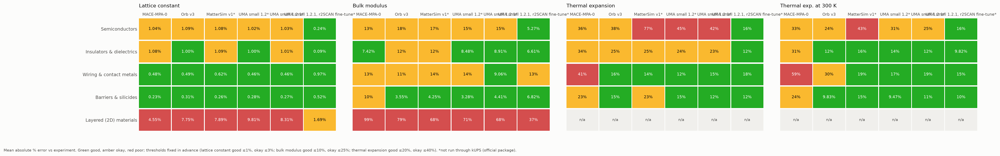
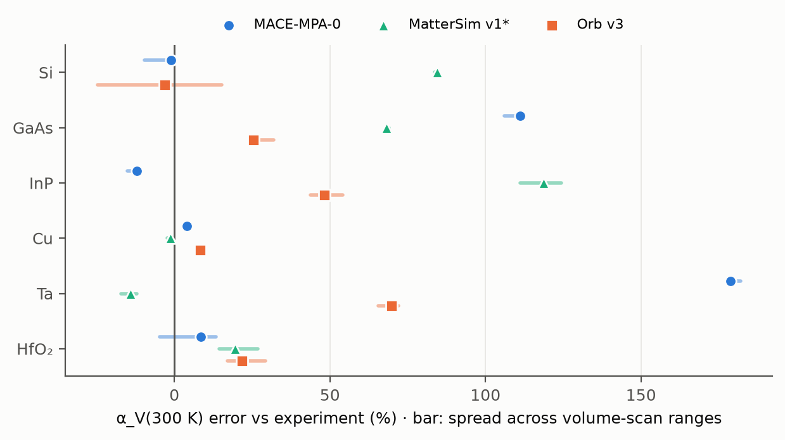

# BeyondStructure Bench

[](https://github.com/anushajain2/chipff-bench/actions/workflows/ci.yml)

**When a machine-learned force field gets a chip material's crystal structure right, does it also get
its stiffness and thermal expansion right? And when it doesn't, why?**

BeyondStructure Bench is a benchmark of three machine-learned (ML) force fields: models that predict how
the atoms in a material push and pull on each other, used as fast stand-ins for quantum-mechanical
calculations. It tests MACE-MPA-0, Orb v3 and MatterSim v1 on 33 materials used in chips, from silicon
and copper to hafnium oxide, and compares every prediction with published lab measurements (and with
[DFT](#terms-used-here) calculations where they exist). A follow-up study of six cases looks at why the
worst predictions go wrong.

**Key findings:**

1. **Getting the structure right doesn't mean getting the rest right.** Accuracy falls as the property
   gets harder: on average the models are off by under 1 % on crystal size, 11–13 % on stiffness and
   29–35 % on thermal expansion. MACE-MPA-0, for example, gets tantalum's crystal size within 0.4 % but
   overestimates its thermal expansion by 179 %.
2. **No model is best everywhere.** Each fails on different materials: MACE-MPA-0 on metals such as
   tantalum, MatterSim on semiconductors such as silicon and indium phosphide. On structure and
   stiffness, the data can't tell the three models apart.
3. **The thermal-expansion errors come from how the models handle vibrations.** In six cases studied in
   depth, the models misjudge how strongly the atoms' vibrations change as the crystal expands. These
   cases were picked after the failures were seen, so this explains them rather than proving a general
   rule.

Averages leave out layered materials such as graphite, which every model gets wrong, and Orb v3's
thermal expansion, which was not computed in this release.

**[Project site](https://anushajain2.github.io/chipff-bench/)** ·
[Explore the evidence](https://anushajain2.github.io/chipff-bench/explore.html) ·
[Read the study](https://anushajain2.github.io/chipff-bench/study.html) ·
[Evaluation design](https://anushajain2.github.io/chipff-bench/design.html) ·
[Reproduce](https://anushajain2.github.io/chipff-bench/reproduce.html)

## What it measures

| Property | In everyday terms | Why it matters for chips |
|---|---|---|
| **Lattice constant** | The size of the crystal's repeating unit: how far apart the atoms sit | Layers grown on top of each other need to fit; a model that gets the size wrong gets everything built on it wrong |
| **Bulk modulus** | How hard the material is to squeeze; a higher value means stiffer | Sets how much a layer pushes back when its neighbours strain it |
| **Thermal expansion** | How much the material grows when it heats up | Chips heat and cool constantly; layers that expand by different amounts build up stress, which can bend, crack or peel them |

The three properties get harder to predict in turn. Crystal size
depends only on where the atoms sit at rest. Stiffness depends on how the energy changes when the
crystal is squeezed. Thermal expansion depends on how the atoms' vibrations change as the crystal grows,
a subtler feature of the model that structure and stiffness don't test. So the benchmark asks whether
accuracy on the easier properties carries over to the harder one.

The 33 materials fall into five groups: semiconductors, insulators and dielectrics, wiring and contact
metals, barriers and silicides, and layered (2D) materials such as graphite. Exact definitions, units and
methods are in [`docs/details.md`](docs/details.md#whats-measured).

## What it adds

* **Thermal expansion against experiment.** Force-field benchmarks mostly test structure and stiffness,
  often against DFT alone. The two closest benchmarks for these kinds of materials,
  [CHIPS-FF](https://arxiv.org/abs/2412.10516) and [UniFFBench](https://arxiv.org/abs/2508.05762), don't
  report thermal expansion against experiment. This one does, for 24 materials at 300 K with two of the models.
* **Evidence that accuracy doesn't carry over between properties.** A model can get a crystal's size
  and stiffness right and its thermal expansion badly wrong: MACE-MPA-0 puts tantalum's lattice within
  0.4 % and its bulk modulus within 6 %, yet overestimates its thermal expansion by 179 %.
* **An explanation for six of the largest failures**, separating model error from software and
  numerical artefacts.
* **Sourced reference data.** Every experimental value comes with its citation and a verbatim quote, so
  others can check and reuse it.

## What it doesn't tell you

This is not a general verdict on whether ML force fields can be trusted for chip materials. It covers
three bulk properties, three models and perfect crystals. Real chip layers are thin films with
interfaces, defects and often disordered structure, and many properties that matter for devices, such as
heat conduction, diffusion and adhesion, are not tested. The results say how these models do on these
properties; for anything else they are at most a warning sign.

## How it works

1. **Pick the materials:** 33 materials with a role in semiconductor devices (`data/materials.yaml`).
2. **Run the models:** each force field finds every crystal's preferred shape, then simulates squeezing it
   and how its atoms vibrate.
   Most calculations run through CuspAI's open-source [kUPS](https://github.com/cusp-ai-oss/kups)
   toolkit; MatterSim runs through its official package, because its kUPS version gives inconsistent
   energies ([details](docs/details.md#findings-in-detail)).
3. **Compute the three properties** from those simulations.
4. **Compare with references:** sourced lab measurements for every material, each with a citation and a
   quote, and DFT values from [Materials Project](https://materialsproject.org) where they exist.
5. **Analyse the errors:** statistics with uncertainty, documented exclusions, checks that the
   results don't depend on arbitrary settings, and a detailed study of the worst failures.

## The evidence



*Average error against lab measurements, by material group (rows), property and model (columns).
Green, amber and red use thresholds fixed before any result was seen (lattice constant good ≤ 1 %,
okay ≤ 3 %; bulk modulus good ≤ 10 %, okay ≤ 25 %; thermal expansion good ≤ 20 %, okay ≤ 40 %).
"Not run" means Orb v3's thermal expansion was not computed in this release; "n/a" means the value was
computed but not graded, because the method does not apply to layered materials. Neither is a score.
Numbers: [`results/trust_map.csv`](results/trust_map.csv). \*MatterSim runs through its official
package, not kUPS.*

**1. Getting the structure right doesn't mean getting the rest right.** Across the 30 non-layered
materials, the three models put the crystal size within 0.73–0.80 % of experiment on average and the
bulk modulus within 11–13 %. At 300 K, thermal expansion is off by 34.5 % on average for MACE-MPA-0 and
28.7 % for MatterSim (24 materials each). Good structure is no guarantee: MACE-MPA-0 puts tantalum's
lattice within 0.4 % and its bulk modulus within 6 %, yet overestimates its thermal expansion by 179 %.

**2. No model is best everywhere.** MACE-MPA-0 overshoots the thermal expansion of refractory metals
(tantalum +179 %); MatterSim overshoots that of semiconductors (InP +119 %, Si +85 %), where MACE gets
silicon within 1 %. Against experiment, the benchmark resolves no overall difference between the models
for lattice constant or bulk modulus (paired bootstrap, 95 % intervals), nor between MACE-MPA-0 and
MatterSim for thermal expansion. Some failures are shared: every model overestimates the spacing between
graphite's layers, by 18–30 %.



*Thermal-expansion error at 300 K against experiment in the six-case study. Each bar is the spread
across three volume-scan settings: a sensitivity range, not a confidence interval. \*MatterSim runs
through its official package, not kUPS.*

**3. The thermal-expansion errors come from how the models handle vibrations.** How much a material
expands depends mainly on its stiffness and its Grüneisen parameter, which measures how strongly its
vibrations change as the crystal expands. In six cases (Si, GaAs, InP, Cu, Ta and HfO₂), checks of the
software and numerical settings did not explain the large errors; they trace to the models' Grüneisen
parameters, with a too-soft bulk modulus adding to it for several semiconductors. For tantalum,
MACE-MPA-0's Grüneisen parameter is 4.1, against 1.6 inferred from experiment. The six cases were chosen
after the failures were seen, so the study explains them; it does not establish a general rule.

Every number above comes from the committed tables in `results/`; the full findings, with confidence
intervals and sample sizes, are in [`docs/details.md`](docs/details.md#findings-in-detail).

## What this release covers

| Scope | Coverage in v1.0.0 |
|---|---|
| Lattice constant and bulk modulus | MACE-MPA-0, Orb v3 and MatterSim v1 on all 33 materials, with exclusions and their reasons |
| Thermal expansion, benchmark-wide | MACE-MPA-0 and MatterSim v1; 24 graded comparisons per model at 300 K, fewer over the temperature windows. Orb v3 is not computed in this release. |
| Thermal-failure study | MACE-MPA-0, MatterSim v1 and Orb v3 on six selected materials (Si, GaAs, InP, Cu, Ta, HfO₂) |
| UMA | Not evaluated in this release (gated licence) |

Not every result can be graded, so coverage is reported next to accuracy
([`results/coverage.csv`](results/coverage.csv)). Each model–material–property result is one of:

* **Graded:** the model gave a valid answer and it is compared with the reference.
* **Model failure:** the model gave an answer that can't be compared, for example Orb changes the crystal
  form of 3 of the 33 materials. These are findings in their own right and are left out of the averages.
* **Method limit:** the calculation method itself doesn't apply, for example thermal expansion of layered
  materials, which grow differently in different directions, or at temperatures where the method breaks down.
* **No reference:** there is no trustworthy lab measurement to compare with.
* **Not computed:** the calculation was not run in this release (Orb v3's benchmark-wide thermal expansion).

## Terms used here

<details>
<summary>Short explanations of the scientific terms (click to expand)</summary>

* **Force field:** a model of how atoms push and pull on each other, used to simulate how a material
  behaves. A **machine-learned (ML)** force field learns this from many quantum-mechanical calculations;
  a **universal** one is meant to work across most of the periodic table rather than for one material.
* **DFT (density functional theory):** the standard quantum-mechanical way to calculate material
  properties. Accurate but slow; it is what ML force fields are trained to imitate.
* **PBE:** the specific DFT approximation behind most training data. It is known to make crystals about
  1 % too large and to miss the weak forces that hold layered materials together.
* **Materials Project:** a public database of DFT calculations, used here as the DFT reference.
* **kUPS:** CuspAI's open-source toolkit for running simulations with these models.
* **Layered (2D) materials:** materials such as graphite, made of sheets held together by weak van der
  Waals forces. PBE misses those forces, so models trained on it get the spacing between sheets wrong.
* **Phonons:** the collective vibrations of atoms in a crystal. Heat is stored in them, and how they
  change with volume decides how much a material expands.
* **Quasi-harmonic approximation (QHA):** the method used here to compute thermal expansion: calculate
  the vibrations at several crystal sizes and find which size is preferred at each temperature
  ([why this method](docs/thermal_method.md)).
* **Grüneisen parameter:** how strongly a material's vibration frequencies change when it expands or is
  squeezed. Too large a value means too much thermal expansion.
* **Barostat:** the part of a simulation that holds pressure constant by letting the crystal change size.
* **Mean absolute % error:** the average size of the error, ignoring whether it is too high or too low.
* **Bootstrap confidence interval:** an uncertainty range obtained by recomputing a result many times on
  random resamples of the materials. A **paired bootstrap** compares two models on the same resamples to
  see whether the difference between them is real or could be chance ([details](docs/robustness.md)).

</details>

## Who can use it

* **Choosing a force field for these materials:** the explorer shows each model's value next to the
  reference, with its source, error and any exclusion reason.
* **Building or evaluating force fields:** the study's per-ingredient comparisons and workflow checks
  show where to look when a property comes out wrong.
* **Running kUPS:** two problems found in the toolkit are written up with reproducers in
  `docs/kups_issue_*_DRAFT.md`.

## Quick start

There are three ways in, from no setup at all to rerunning the simulations.

**1. Explore (no install).** The [site](https://anushajain2.github.io/chipff-bench/), or the committed
tables in `results/` (`summary.json` and the CSVs) and `report/index.html`.

**2. Reanalyse (Python only, no simulations).** Rebuild every table and figure from the committed raw
results:

```bash
uv venv --python 3.12 && uv pip install -e ".[dev]"
chipff analyze && chipff report
```

**3. Run simulations.** One model on one material, in about two minutes on a laptop CPU (measured on an
Apple-silicon MacBook). This recomputes the stored silicon results for MACE-MPA-0; they should agree
with the committed ones to about 0.2 %. kUPS logs "Fixing failed assertions" while it enlarges its
neighbour-list buffers; that is expected, not an error.

```bash
chipff static -m mace-mpa-0 --materials Si --force
chipff qha -m mace-mpa-0 --materials Si --force
chipff analyze
```

The full pipeline (roughly an hour on CPU for the static properties and one to two hours per model for
thermal expansion), the MatterSim environment and UMA access are on the
[Reproduce page](https://anushajain2.github.io/chipff-bench/reproduce.html) and in
[`docs/details.md`](docs/details.md#reproduce).

## Scientific details and reproducibility

| What | Where |
|---|---|
| Full findings, methods and limits | [`docs/details.md`](docs/details.md) |
| Statistics and robustness checks | [`docs/robustness.md`](docs/robustness.md) |
| The six-case thermal-failure study | [`docs/thermal_failure_study.md`](docs/thermal_failure_study.md) |
| Why thermal expansion uses QHA, not molecular dynamics | [`docs/thermal_method.md`](docs/thermal_method.md) |
| Every setting, the pre-registered thresholds and rules, and dated changes | [`configs/benchmark.yaml`](configs/benchmark.yaml) |
| Experimental references, each with a source, citation and quote | [`data/experimental/`](data/experimental) |
| Exact package versions | [`env/requirements-lock.txt`](env/requirements-lock.txt), [`env/requirements-mattersim-lock.txt`](env/requirements-mattersim-lock.txt) |
| Model files and checksums | [`configs/checkpoints.json`](configs/checkpoints.json), checked by `scripts/verify_checkpoints.py` |
| How each result is tied to the code and settings that made it | [`docs/provenance.md`](docs/provenance.md) |
| Automatic self-checks on every result | [`results/checks.csv`](results/checks.csv) |

**Related benchmarks.** [CHIPS-FF](https://arxiv.org/abs/2412.10516) compares 16 force fields with DFT
on 104 semiconductor-relevant materials, and [UniFFBench](https://arxiv.org/abs/2508.05762) compares
six with experiment on minerals. Neither reports thermal expansion against experiment.

**Agent interface.** `chipff-mcp` is a Model Context Protocol server that lets an AI assistant
retrieve the same evidence. Its answers are benchmark evidence, not calibrated error estimates.

## Citation

> A. Jain, *BeyondStructure Bench: how reliably universal machine-learned force fields predict the structure,
> stiffness and thermal expansion of semiconductor-device materials*, v1.0.0 (2026).
> https://github.com/anushajain2/chipff-bench

## Licence

Code: MIT. Model weights keep their own licences (MIT, Apache-2.0, FAIR Chemistry License). Experimental
values are cited from the sources listed with each one. This is an independent project built on kUPS and
published model exports; it is not affiliated with or endorsed by CuspAI, Meta, Microsoft, Orbital
Materials or the MACE developers.
