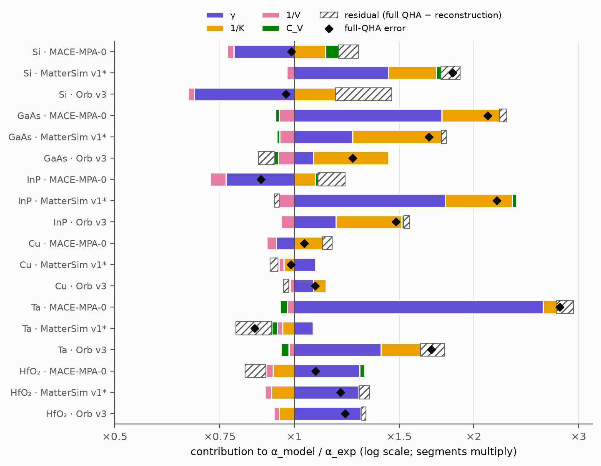
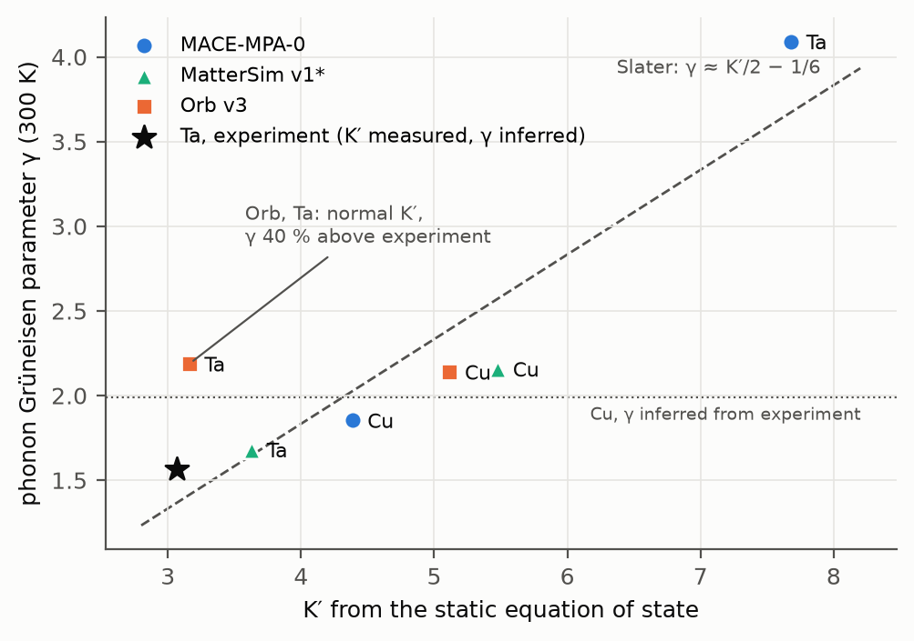

# Why MACE-MPA-0, MatterSim v1 and Orb v3 mispredict thermal expansion: a controlled study

The benchmark's QHA results (`results/thermal_expansion.csv`, after the Γ-mode fix of section 2) show large,
model-specific errors at 300 K. MACE-MPA-0 overshoots Ta (+179 %) and GaAs (+111 %), and MatterSim v1 overshoots InP
(+119 %), Si (+85 %) and GaAs (+68 %). Yet MACE gets Si within about 1 %, and MatterSim gets Ta within 14 %. Orb v3, added later as a third model family on the
same cases, overshoots Ta (+70 %), InP (+48 %), GaAs (+25 %) and HfO₂ (+22 %), and gets Si within 4 % and Cu within 8 %.
This study takes six cases (Si, GaAs, Cu, Ta, InP and monoclinic HfO₂) and asks three questions:

1. **Is it the software route?** Do the backends the benchmark used give the same energies, forces and
   stresses as the official packages?
2. **Is it numerics?** How much do the QHA settings move α, including how phonopy treats imaginary modes?
3. **If it is the model, which ingredient?** α_V ≈ γ C_V / (K_T V) is split into the Grüneisen parameter,
   heat capacity, bulk modulus and volume, and each is compared with experiment.

Everything is reproduced by `scripts/thermal_failure_study.py`, and the raw data are in `results/thermal_failure/`
(see [Reproduce](#reproduce)). The tables marked in this file's source are written into it from the CSVs by
`analyze`, so they cannot drift from the data. Only the small K′ table in section 4 is typed by hand.

## Summary

The six cases were chosen after the benchmark had shown where MACE and MatterSim fail, with Cu (and MatterSim on Ta,
MACE on Si) as the only cases that work. Orb was then run on the same cases with settings fixed in advance. What follows explains these cases and gives hypotheses to test on
other materials; it does not establish rules that hold beyond them.

* **The software route does not explain MACE's errors in these cases.** On identical structures the kUPS export and the official
  `mace-torch` package agree to ≤ 0.01 meV/atom in energy and ≤ 0.04 meV/Å in force. The force response to a phonon
  displacement agrees to 0.04 %. **MatterSim's kUPS export is unusable**: it returns NaN on primitive cells, is off by up
  to 0.7 eV/atom elsewhere, and gets the displacement response wrong by 5–54 %. That confirms the benchmark's
  decision to run MatterSim through its official package. Orb's kUPS export agrees with the official `orb-models`
  package to ≤ 0.07 meV/atom and to 0.05–0.3 % in the displacement response.
* **The published QHA contained a numerical defect, but it is small next to the model errors.** `chipff.qha` let the
  three acoustic modes at Γ into the vibrational free energy whenever their computed frequency (≈ 10⁻⁷ THz, sign random)
  happened to be positive. At the benchmark's q-mesh that adds random 0.05–0.2 meV/atom jumps between volumes, so
  repeated runs scatter by up to ±8 % in α(300 K) (MatterSim Si; MACE InP +6 %). The size depends on the conditions:
  the Γ point's weight in the mesh (1/N_q), force noise large enough to flip the near-zero modes, and a quantity
  built from small free-energy differences, as thermal expansion is. A denser mesh shrinks it (section 2). It also makes MatterSim results irreproducible: GaAs gave 28.5 / 29.9 /
  28.7 in three fresh processes. With the modes excluded, the runs agree to 0.1 %. For these six cases the published
  values happen to lie within ±2 % of the corrected ones.
* **With that fixed, the numerical checks performed move α far less than the large errors.** A 3× larger
  displacement and a 14 Å supercell move α(300 K) by ≤ 2 %, except MACE InP at 14 Å (+7 %). The volume-scan range moves it
  by up to 9 % (MACE Si) and 12 % (MACE HfO₂). Keeping the imaginary modes that phonopy drops moves it by ≤ 1 %, except
  HfO₂ (+6 % MACE). None of these comes near the 70–180 % errors. Not every check was run for every case
  (see Scope), and HfO₂ remains sensitive to settings.
* **By elimination, the large errors sit in the models' Grüneisen parameters, sometimes compounded by a soft bulk
  modulus.** Heat capacity, volume and bulk modulus are each compared with independent experimental values: heat
  capacity and volume are within 6 % everywhere. The models' γ is computed independently from phonons at three
  volumes, and with C_V and K_T it rebuilds the model's own α to within 10–15 %, except Orb's Si (20 %). The experimental γ, however, is
  *inferred* from the measured α with the same relation, so the γ ratio is what remains once K, C_V and V are
  accounted for, not an independent measurement. The direct experimental checks on γ are a few mode values: TA(X) and
  TA(L) for Si, and TO(Γ) for GaAs and InP. All comparisons are with experiment; whether the errors are the models'
  own or inherited from PBE is not tested here (section 7).
  * **MACE on Ta:** γ = 4.1 against 1.56 inferred from experiment. On the full phonon mesh every mode has γ ≥ 2.1, above
    the measured average; there is no mode-resolved experimental γ to compare with. MACE's static equation of state
    (K′ = 7.7 against a measured 3.1) corroborates an energy-volume curve that stiffens too fast under compression.
  * **The semiconductors (MACE GaAs; MatterSim Si, GaAs, InP):** the optical modes match experiment (γ_TO at Γ within
    5 % for these two models, within 12 % for Orb). Over the whole Brillouin zone, the difference between models sits in the acoustic branches, whose
    negative-γ modes normally cancel much of the expansion. The transverse acoustic modes at the zone edge illustrate
    it: MatterSim's are barely negative (Si TA(X) −0.64 vs −1.4 measured) or positive (InP), and MACE's GaAs TA(L) is
    +1.8. Two q-points per material illustrate the mechanism; they do not measure the zone-edge share of the
    integrated error. On top of this, MatterSim's K_T is 17–29 % too soft for these three.
  * **MACE gets Si right partly by cancellation:** its γ is 21 % too *low* (TA(X) −2.84, too negative) while its K_T
    is 11 % too soft.
* **Orb v3 separates the shared failures from the model-specific ones** (on these cases, with the pipeline shared by
  all three models):
  * **The semiconductor TA-mode failure is not shared.** Orb's zone-edge TA modes are clearly negative in Si, GaAs and
    InP (TA(X) −2.23, −1.06, −0.96), and its γ is within 8–17 % of the inferred value for GaAs and InP. Its overshoots
    there (+25 %, +48 %) come mostly from a bulk modulus 22–25 % too soft, the same softness MatterSim shows. Soft
    semiconductor bulk moduli are thus shared by two models; the wrong-signed TA modes belong to MatterSim (and to MACE's
    GaAs).
  * **The Ta γ error is shared, in different sizes.** Orb's γ for Ta is 2.19 against 1.56 (+40 %), with K_T 14 % soft,
    giving +70 %. MACE's is 4.09, while MatterSim's (1.68) is close.
  * **Orb's apparent Si accuracy is fragile.** Like MACE, Orb has a γ that is too low (0.32; TA(X) −2.23) and a K_T
    that is too soft (84 GPa). But the two only partly compensate: the γ C_V/(K_T V) reconstruction gives 6.1, still
    22 % below experiment. The full QHA reaches 7.6, within 4 %, only through a 20 % reconstruction residual, and the
    volume-scan range moves it from 5.9 to 9.1. Compensating ingredient errors and numerical sensitivity together
    leave Orb's Si unresolved. It is a caution, not a second clean case of cancellation; MACE's Si remains the clean one.
  * **A counterexample to the K′ shortcut.** Orb's static K′ for Ta is normal (3.16, measured 3.07), yet its phonon γ
    is 40 % too high, so K′ gives no warning of Orb's +70 % Ta error. The γ is robust to how the displacements are
    generated and to the export (≤ 0.6 % in α, section 3). This is a counterexample on an additional model,
    using the previously selected cases; it is not a validation set, and no decision threshold had been fixed. The
    static properties are not reassuring either: Orb's bulk modulus for Ta is already 11–14 % soft. That hints at a
    problem, but with everything else fixed it would explain only about 12–16 % of extra expansion (1/0.89 to 1/0.86),
    not 70 %.
* **HfO₂ is the case where numerics and reference data matter as much as the model.** All three models give γ ≈ 1.46–1.47
  against 1.14 (+28 %), partly offset by a 6–9 % stiff K. But at 400–1500 K, α depends on how imaginary
  interpolation modes are treated (+15 to +25 %) and on the volume-scan range (±13 %). The experimental reference is
  a provisional TPRC compilation. These sensitivities suggest the HfO₂ window comparison could move by about ±20 % for
  reasons unrelated to the models; that is an indication, not a calibrated uncertainty.


*α_V(300 K) error against experiment for each material and model (Γ fixed). The bar is the spread across the three
volume-scan ranges; Orb's Si spans −25 % to +15 %.*

## Scope, settings, and what was not run

* QHA settings follow `configs/benchmark.yaml` `thermal_qha` (Vinet EOS, 9 volumes 0.96–1.08 V0, supercell ≥ 10 Å,
  0.01 Å displacements, reference forces subtracted, force constants symmetrised, stability judged at commensurate
  q-points, mesh length 50). Each relaxed cell is the benchmark's own (`results/raw/<model>/lattice.json`), symmetrised
  as in `chipff.qha`. The phonon steps are those of `chipff.qha.run_qha`, which is reused for symmetrisation,
  supercells and batched forces. The raw forces are kept so that every variant can be re-analysed without new force calls.
  Rerunning the benchmark's own settings reproduces the published α(300 K) to within the Γ-acoustic noise described
  below: MACE Cu, Ta and HfO₂ to 0–1 %, the rest to ≤ 8 %.
* Backends: MACE-MPA-0 through the CuspAI tojax export in kUPS 1.0.8 (what the benchmark used) and through
  `mace-torch` 0.3.16 (`medium-mpa-0`, float64 and float32). MatterSim v1 5M through `mattersim` 1.2.5 (what the
  benchmark used) and through its kUPS tojax export (excluded from the benchmark; contrast only). Orb v3
  (conservative, OMat) through the CuspAI tojax export in kUPS (what the benchmark uses) and through the official
  `orb-models` 0.7.0 package in float64.
* **Not run, to limit compute time:** the 14 Å supercell check for MACE on HfO₂, Cu and Ta (it would have roughly
  tripled the study's run time, to about 2 h on a laptop CPU). The 14 Å check was run for every other case (MACE Si,
  GaAs, InP; MatterSim all six). For MACE Cu and Ta, the 0.03 Å displacement and volume-scan checks were run and moved
  α by ≤ 1 % at 300 K. A full QHA through `mace-torch` was not run either: the single-point agreement
  (0.04 % in the displacement response) makes it redundant. The MatterSim export was compared on single points only,
  because a QHA built on a broken potential would be meaningless.
* **Orb v3 was added afterwards** (2026-10-20) as a third model family, on the same six cases, with fixed settings
  decided before its results were seen: the volume grid (benchmark scan, narrower and wider scans, the imaginary-mode
  sensitivity), the Grüneisen split and the native-vs-export single points. The 0.03 Å and 14 Å checks were not run
  for Orb. Orb is not built to be exactly equivariant: its relaxed cells carry slightly broken symmetry, so phonopy
  needs more displacements (Si 4–6 instead of 1; HfO₂ 72 per volume). phonopy's displacement scheme also assumes that
  symmetry-equivalent displacements give equivalent forces, which a non-equivariant model need not satisfy, and
  symmetrising the force constants afterwards does not prove that harmless. This was tested on Ta, the key Orb case
  (section 3): α changes by ≤ 0.6 %. Si and the other Orb cases were not tested this way. Orb's HfO₂ run was split across processes, a few volumes each, to stay within
  memory (`--chunk`). Orb's benchmark-wide thermal results (7 of 33 materials) still predate the Γ fix and are not
  used here.

## 1. Native vs export on identical structures

Each case has six structures, built from the model's benchmark-relaxed cell: the primitive cell at 1.0, 0.96 and 1.06 V0;
the benchmark's 10 Å phonon supercell undisplaced; the same with its first 0.01 Å displacement; and the supercell rattled
by 0.03 Å. *Displacement response* is the relative difference of F(displaced) − F(undisplaced) between the two routes.
That difference is what the force constants are built from.

<!-- table:agreement -->
| model | reference → other | material | max ΔE (meV/atom) | Δ[E(1.06 V0) − E(0.96 V0)] (meV/atom) | max ΔF (meV/Å) | max Δσ (GPa) | Δ displacement response | NaN frames |
|---|---|---|---|---|---|---|---|---|
| mace | mace-kups → mace-torch | Si | 0.003 | 0.002 | 0.015 | 0.0001 | 0.0285 % | 0 |
| mace | mace-kups → mace-torch | GaAs | 0.002 | 0.000 | 0.011 | 0.0001 | 0.0152 % | 0 |
| mace | mace-kups → mace-torch | Cu | 0.005 | 0.002 | 0.004 | 0.0001 | 0.00795 % | 0 |
| mace | mace-kups → mace-torch | Ta | 0.006 | 0.001 | 0.012 | 0.0003 | 0.0233 % | 0 |
| mace | mace-kups → mace-torch | InP | 0.001 | 0.001 | 0.010 | 0.0000 | 0.0195 % | 0 |
| mace | mace-kups → mace-torch | HfO2 | 0.009 | 0.000 | 0.019 | 0.0001 | 0.0124 % | 0 |
| mace | mace-kups → mace-torch32 | Si | 0.002 | 0.002 | 0.033 | 0.0002 | 0.0251 % | 0 |
| mace | mace-kups → mace-torch32 | GaAs | 0.001 | 0.000 | 0.022 | 0.0001 | 0.0196 % | 0 |
| mace | mace-kups → mace-torch32 | Cu | 0.002 | 0.002 | 0.010 | 0.0001 | 0.0134 % | 0 |
| mace | mace-kups → mace-torch32 | Ta | 0.005 | 0.001 | 0.022 | 0.0009 | 0.0413 % | 0 |
| mace | mace-kups → mace-torch32 | InP | 0.001 | 0.000 | 0.018 | 0.0000 | 0.0238 % | 0 |
| mace | mace-kups → mace-torch32 | HfO2 | 0.002 | 0.001 | 0.039 | 0.0002 | 0.0193 % | 0 |
| mattersim | mattersim-native → mattersim-kups | Si | 554.700 | – | 650.700 | 1.4210 | 14.1 % | 3 |
| mattersim | mattersim-native → mattersim-kups | GaAs | 716.200 | – | 1036.000 | 6.5480 | 54.2 % | 3 |
| mattersim | mattersim-native → mattersim-kups | Cu | 34.470 | – | 226.600 | 1.9070 | 4.82 % | 2 |
| mattersim | mattersim-native → mattersim-kups | Ta | 2.369 | – | 340.500 | 2.2180 | 17.3 % | 3 |
| mattersim | mattersim-native → mattersim-kups | InP | 628.800 | – | 717.900 | 3.6230 | 17.5 % | 3 |
| mattersim | mattersim-native → mattersim-kups | HfO2 | 24.140 | – | 1218.000 | 13.7700 | 23.6 % | 2 |
| orb | orb-kups → orb-torch | Si | 0.012 | 0.011 | 2.453 | 0.0084 | 0.0848 % | 0 |
| orb | orb-kups → orb-torch | GaAs | 0.004 | 0.003 | 1.556 | 0.0117 | 0.0921 % | 0 |
| orb | orb-kups → orb-torch | Cu | 0.007 | 0.003 | 0.398 | 0.0039 | 0.0547 % | 0 |
| orb | orb-kups → orb-torch | Ta | 0.009 | 0.009 | 2.970 | 0.0117 | 0.294 % | 0 |
| orb | orb-kups → orb-torch | InP | 0.022 | 0.013 | 1.326 | 0.0068 | 0.099 % | 0 |
| orb | orb-kups → orb-torch | HfO2 | 0.068 | 0.044 | 5.213 | 0.0187 | 0.104 % | 0 |
<!-- /table:agreement -->

The MatterSim export returns NaN for most primitive-cell frames (2–3 of the 3 per material, 1–12 atoms), so its E(V)
differences cannot be formed. The maxima are over the frames that are finite. The MACE export is effectively exact, including
in float32. Its "_32" suffix does not cost precision at the level phonons need. The mace-torch float64 vs float32
comparison (not shown, in `agreement.csv`) is of the same size. Orb's export is less exact than MACE's. Forces differ
by up to 5 meV/Å (HfO₂), but energies agree to ≤ 0.07 meV/atom and the displacement response to ≤ 0.3 %. That is
reassuring, but it does not rigorously bound the error in frequencies or γ. γ is a difference between volumes, and soft
modes can amplify small force differences. For Orb's Ta, the key Orb case, γ and α were therefore also computed through
the official package directly (section 3). **Conclusion: on these cases, the backends the benchmark used do not
explain the thermal-expansion errors.**

## 2. A numerical defect: Γ-point acoustic modes in the free energy

`chipff.qha.run_qha` calls `Phonopy.run_thermal_properties` with phonopy's defaults: modes with frequency ≤ 0 are left
out, and `exclude_gamma_acoustic` is off. The three acoustic modes at Γ should be exactly zero. After symmetrisation
they come out at about 10⁻⁷ THz, of random sign. Each one that happens to be positive adds kT ln(hν/kT)/N_q to F_vib.
At 300 K that is about 0.05–0.2 meV/atom (table below), and it changes from one volume to the next. The relevant
energy scale is the thermal free-energy difference across the scan, a few meV, so this is not negligible. phonopy 4.8.3
describes exactly this effect in `phonopy/phonon/thermal_properties.py` (`_treat_gamma_acoustic`) and offers
`exclude_gamma_acoustic=True` as the fix.

**This explains the irreproducible MatterSim results.** The committed GaAs α(300 K) is 29.03 and a rerun gave 30.19,
with identical package versions: mattersim 1.2.5, torch 2.14.1, ase 3.29.0 and phonopy 4.8.3, in the committed
record's provenance, in `env/requirements-mattersim-lock.txt` and in `.venv-mattersim` alike. `MatterSimCalculator` is
bit-identical on repeated single points in one process. In fresh processes its forces differ by up to 8 × 10⁻⁷ (GaAs)
to 4 × 10⁻⁶ eV/Å (Si), which is multithreaded CPU summation order; energies are identical. Force noise that small
changes the force constants by ~10⁻⁵, which flips the signs of the Γ-acoustic frequencies:

<!-- table:determinism -->
| backend | material | fresh processes | max ΔF, same process (eV/Å) | max ΔF, across processes (eV/Å) | α_V(300 K) as the benchmark computed it | α_V(300 K), Γ acoustic modes excluded |
|---|---|---|---|---|---|---|
| mattersim-native | GaAs | 3 | 0.0 | 7.9e-07 | 28.48 / 29.94 / 28.69 | 28.91 / 28.92 / 28.92 |
| mattersim-native | Si | 3 | 0.0 | 3.72e-06 | 14.32 / 14.38 / 14.34 | 14.50 / 14.51 / 14.50 |
<!-- /table:determinism -->

Adding Gaussian noise of 3 × 10⁻⁶ eV/Å to the saved Si forces moves α(300 K) between 14.0 and 15.6 as the benchmark
computes it, and between 14.47 and 14.53 with the Γ modes excluded. MACE through kUPS is affected too. Our rerun of the
benchmark's settings differs from the published run by −1 % to +6 % (convergence table, *rerun* vs *Γ fixed*), presumably
because the batches differ and the resulting tiny force differences flip the Γ-mode signs. The batch cause was not
isolated.

**Effect on the published numbers:** the published α(300 K) of these six cases lies within ±2 % of the Γ-fixed values
(largest: MatterSim InP 28.06 vs 27.49, Ta 15.96 vs 16.26). A rerun can land anywhere within about ±8 %. The defect is real
and should be fixed; passing `exclude_gamma_acoustic=True` changes nothing else. It does not explain any of the large
errors. In the rest of this study, "Γ fixed" values are the reference.

**When it matters.** The effect needs three things together. First, a Γ point with enough weight in the q-mesh: each
Γ mode carries 1/N_q, so denser meshes shrink it. Second, force noise large enough to flip the signs of the near-zero
modes. Third, a quantity built from small free-energy differences between volumes, as thermal expansion is. The
regression test in `tests/test_core.py` shows the range on a model-free EMT copper crystal with 3 × 10⁻⁶ eV/Å of
force noise. At the benchmark's mesh density, α(300 K) scatters by 0.4 % across noise seeds; on a coarse mesh
(mesh length 10 Å) it comes out as −33, +15 and −1.7 × 10⁻⁶ K⁻¹, against 61.9 ± 0.05 with the modes excluded. phonopy
itself warns when Γ acoustic modes enter its sums. So the defect is specific to these conditions, not to every use of
phonopy's thermal properties.

**Applied (2026-10-20).** `thermal_qha.exclude_gamma_acoustic: true` is now the benchmark's setting, and the QHA
was rerun for MACE-MPA-0 and MatterSim v1 (all 33 materials each; Orb v3's partial run is left as it was and
is now marked stale). Across the 33 materials, α(300 K) changed by a median of 0.7 % (largest: GaN, −3.7 % MACE and
+3.9 % MatterSim). The window averages changed by a median of 0.4–0.8 %. The rerun reproduces this study's
"Γ fixed" values (e.g. Ta window 46.70, Si window 19.91 and 11.04). Headline effects: mean absolute error at 300 K
moves 34.4 → 34.5 % (MACE) and 29.2 → 28.7 % (MatterSim), and the benchmark still does not resolve a difference
between them. MACE Ta now passes
the "volume inside scan" check, and MatterSim's metals at 300 K move from 20.3 % (okay) to 19.4 % (good).

## 3. Convergence on the hard cases

α_V(300 K) in 10⁻⁶ K⁻¹. *Published before the fix*: the benchmark's results at commit `4265a65`, before the Γ-mode fix
(the published results now equal *Γ fixed*). *Rerun as the benchmark ran it*: the same pre-fix settings, this study's
data. *Γ fixed*: Γ-point acoustic modes excluded from F_vib. Every column to its right also has them excluded, and
percentages are relative to it. The last column puts every mesh mode with ν < 0 (which phonopy drops) back into F_vib
at |ν|. That is a sensitivity test, not a bound: phonopy's documentation says this treatment (`PRETEND_REAL`) gives false
thermal properties and is for testing only.

<!-- table:convergence -->
| model | material | published before the fix | rerun as the benchmark ran it | **Γ fixed** | disp 0.03 Å | supercell 14 Å | scan 0.975–1.045 | scan 0.94–1.12 | sensitivity: imaginary modes at abs(ν) |
|---|---|---|---|---|---|---|---|---|---|
| mace-kups | Si | 7.83 | 7.66 (-1 %) | **7.77** | 7.77 (-0 %) | 7.81 (+0 %) | 7.59 (-2 %) | 7.09 (-9 %) | 7.77 (+0 %) |
| mace-kups | GaAs | 36.03 | 36.85 (+1 %) | **36.30** | 36.19 (-0 %) | 36.29 (-0 %) | 36.52 (+1 %) | 35.41 (-2 %) | 36.30 (+0 %) |
| mace-kups | Cu | 51.79 | 51.79 (+0 %) | **51.65** | 51.64 (-0 %) | not run | 51.76 (+0 %) | 51.70 (+0 %) | 51.65 (+0 %) |
| mace-kups | Ta | 52.53 | 52.53 (-1 %)† | **52.82** | 52.56 (-0 %) | not run | 53.44 (+1 %)† | 52.84 (+0 %) | 53.04 (+0 %)† |
| mace-kups | InP | 10.98 | 11.67 (+6 %) | **11.06** | 11.09 (+0 %) | 11.87 (+7 %) | 10.67 (-4 %) | 11.07 (+0 %) | 11.06 (+0 %) |
| mace-kups | HfO2 | 18.48 | 18.46 (+1 %) | **18.37** | 18.43 (+0 %) | not run | 16.13 (-12 %) | 19.17 (+4 %) | 19.41 (+6 %) |
| mattersim-native | Si | 14.56 | 13.34 (-8 %) | **14.49** | 14.36 (-1 %) | 14.47 (-0 %) | 14.48 (-0 %) | 14.42 (-0 %) | 14.49 (+0 %) |
| mattersim-native | GaAs | 29.03 | 29.50 (+2 %) | **28.92** | 28.91 (-0 %) | 29.01 (+0 %) | 28.90 (-0 %) | 29.06 (+0 %) | 28.92 (+0 %) |
| mattersim-native | Cu | 48.79 | 48.92 (-0 %) | **49.09** | 49.15 (+0 %) | 49.08 (-0 %) | 49.32 (+0 %) | 48.51 (-1 %) | 49.09 (+0 %) |
| mattersim-native | Ta | 15.96 | 16.19 (-0 %) | **16.26** | 16.41 (+1 %) | 16.32 (+0 %) | 16.66 (+2 %) | 15.71 (-3 %) | 16.26 (+0 %) |
| mattersim-native | InP | 28.06 | 26.72 (-3 %) | **27.49** | 27.37 (-0 %) | 27.56 (+0 %) | 28.20 (+3 %) | 26.55 (-3 %) | 27.49 (+0 %) |
| mattersim-native | HfO2 | 20.33 | 20.03 (-1 %) | **20.23** | 20.24 (+0 %) | 19.88 (-2 %) | 19.37 (-4 %) | 21.46 (+6 %) | 20.04 (-1 %) |
| orb-kups | Si | 8.25 | 7.63 (+0 %) | **7.61** | not run | not run | 5.92 (-22 %) | 9.06 (+19 %) | 7.61 (+0 %) |
| orb-kups | GaAs | 21.10 | 22.27 (+3 %) | **21.55** | not run | not run | 22.57 (+5 %) | 22.69 (+5 %) | 21.55 (+0 %) |
| orb-kups | Cu | not run | 53.29 (-1 %) | **53.85** | not run | not run | 53.74 (-0 %) | 54.03 (+0 %) | 53.85 (+0 %) |
| orb-kups | Ta | not run | 31.90 (-1 %) | **32.18** | not run | not run | 31.36 (-3 %)† | 32.61 (+1 %) | 31.37 (-3 %) |
| orb-kups | InP | 19.45 | 17.85 (-4 %) | **18.63** | not run | not run | 19.37 (+4 %) | 18.06 (-3 %) | 18.63 (+0 %) |
| orb-kups | HfO2 | not run | 20.98 (+2 %) | **20.61** | not run | not run | 19.80 (-4 %)† | 21.89 (+6 %) | 21.15 (+3 %) |
<!-- /table:convergence -->

† V(T) leaves the stable scanned range inside the material's window (the benchmark's "volume inside scan" check fails).
The 300 K value is unaffected, but the window average is not usable. "skipped": not run, to limit compute time
(see Scope).

The same checks, averaged over each material's pre-registered window:

<!-- table:window -->
| model | material | window (K) | **Γ fixed** | disp 0.03 Å | supercell 14 Å | scan 0.975–1.045 | scan 0.94–1.12 | sensitivity: imaginary modes at abs(ν) |
|---|---|---|---|---|---|---|---|---|
| mace-kups | Si | 500–800 | **11.05** | 11.07 | 11.07 | 11.02 | 10.30 | 11.05 |
| mace-kups | GaAs | 300–750 | **37.79** | 37.74 | 37.82 | 37.61 | 37.42 | 37.79 |
| mace-kups | Cu | 300–650 | **57.49** | 57.43 | not run | 58.80 | 56.64 | 57.49 |
| mace-kups | Ta | 300–1600 | **46.70** | 46.25 | not run | 69.57† | 41.41 | 49.04† |
| mace-kups | InP | 350–650 | **13.24** | 13.28 | 14.09 | 12.94 | 13.18 | 13.24 |
| mace-kups | HfO2 | 400–1500 | **19.47** | 19.52 | not run | 22.04 | 19.57 | 24.29 |
| mattersim-native | Si | 500–800 | **19.91** | 19.76 | 19.88 | 19.96 | 19.75 | 19.91 |
| mattersim-native | GaAs | 300–750 | **31.82** | 31.80 | 31.93 | 32.00 | 31.78 | 31.82 |
| mattersim-native | Cu | 300–650 | **49.71** | 49.81 | 49.71 | 49.58 | 49.74 | 49.71 |
| mattersim-native | Ta | 300–1600 | **13.84** | 14.01 | 13.89 | 13.54 | 14.22 | 13.84 |
| mattersim-native | InP | 350–650 | **28.75** | 28.68 | 28.89 | 29.10 | 28.14 | 28.75 |
| mattersim-native | HfO2 | 400–1500 | **24.38** | 24.40 | 24.71 | 26.70 | 23.55 | 28.37 |
| orb-kups | Si | 500–800 | **11.30** | not run | not run | 10.35 | 13.28 | 11.30 |
| orb-kups | GaAs | 300–750 | **24.01** | not run | not run | 23.62 | 25.08 | 24.01 |
| orb-kups | Cu | 300–650 | **57.10** | not run | not run | 53.61 | 58.80 | 57.10 |
| orb-kups | Ta | 300–1600 | **39.82** | not run | not run | 47.30† | 38.88 | 40.80 |
| orb-kups | InP | 350–650 | **21.74** | not run | not run | 22.30 | 20.79 | 21.74 |
| orb-kups | HfO2 | 400–1500 | **25.90** | not run | not run | 29.81† | 25.10 | 29.86 |
<!-- /table:window -->

**What the free energy leaves out.** At V0 and at 1.08 V0, 300 K:

<!-- table:imaginary -->
| model | material | V/V0 | mesh modes with ν < 0 | lowest mesh ν (THz) | F_vib (meV/atom) | Γ acoustic modes: F they add (meV/atom) | imaginary modes at abs(ν): ΔF (meV/atom) |
|---|---|---|---|---|---|---|---|
| mace-kups | Ta | 1.00 | 0.00 % | 0.00 | -57.95 | -0.157 | 0.000 |
| mace-kups | Ta | 1.08 | 0.09 % | -0.19 | -83.03 | -0.157 | -0.242 |
| mace-kups | HfO2 | 1.00 | 0.29 % | -1.69 | 33.73 | -0.082 | -0.413 |
| mace-kups | HfO2 | 1.08 | 1.11 % | -2.34 | 25.61 | -0.092 | -1.515 |
| mattersim-native | Ta | 1.00 | 0.01 % | -0.00 | -69.32 | -0.051 | 0.000 |
| mattersim-native | Ta | 1.08 | 0.01 % | -0.00 | -76.68 | 0.000 | 0.000 |
| mattersim-native | HfO2 | 1.00 | 0.10 % | -1.24 | 38.16 | -0.084 | -0.160 |
| mattersim-native | HfO2 | 1.08 | 0.52 % | -1.66 | 28.00 | -0.094 | -0.800 |
| orb-kups | Ta | 1.00 | 0.09 % | -0.25 | -52.96 | -0.149 | -0.225 |
| orb-kups | Ta | 1.08 | 0.09 % | -0.23 | -68.78 | -0.156 | -0.232 |
| orb-kups | HfO2 | 1.00 | 0.10 % | -1.14 | 38.14 | 0.000 | -0.162 |
| orb-kups | HfO2 | 1.08 | 0.45 % | -1.76 | 27.37 | -0.049 | -0.685 |
| orb-torch | Ta | 1.00 | 0.10 % | -0.25 | -52.99 | 0.000 | -0.224 |
| orb-torch | Ta | 1.08 | 0.09 % | -0.23 | -68.80 | -0.154 | -0.231 |
<!-- /table:imaginary -->

In the other cubic cases, ≤ 0.02 % of mesh modes fall below zero, and keeping them changes F by < 0.001 meV/atom (full
table: `results/thermal_failure/imaginary_modes.csv`). For HfO₂, the imaginary modes appear only between the
commensurate q-points (interpolation artefacts of a 2×2×2 supercell in a polar crystal, as `docs/thermal_method.md`
explains). They grow with volume, so dropping them biases the volume dependence of F. That matters little at 300 K
(+6 % for MACE, −1 % for MatterSim) but adds +16 % (MatterSim) to +25 % (MACE) to the 400–1500 K window average. The
14 Å (3×3×3) supercell, run for MatterSim, leaves α(300 K) within 2 % and the window within 1.4 %. So most of the
window sensitivity comes from how the leftover artefacts are treated, not from truncating the force constants.

**Orb: displacement handling and the official package.** Orb is not exactly equivariant. phonopy's default scheme uses
the crystal's symmetry to compute forces for a few displacements and rebuilds the rest by rotation, so for Orb that
assumption needs a test. For bcc Ta it rests on a single displacement per volume. The check reruns Orb's Ta three
ways: with explicit ± displacements; with ± displacements and no symmetry reduction (x, y and z displaced separately,
only the exact lattice translations used); and through the official `orb-models` package instead of the kUPS export.

<!-- table:orb_checks -->
| material | route | displacements per volume | α_V(300 K) | Δ vs benchmark route | window α_V | γ | K_T (GPa) | lowest mesh ν at V0 (THz) |
|---|---|---|---|---|---|---|---|---|
| Ta | kUPS export, phonopy symmetry reduction (benchmark) | 1 | 32.18 | — | 39.82 | 2.187 | 163.4 | -0.25 |
| Ta | kUPS export, explicit ± displacements, symmetry reduction | 2 | 32.18 | -0.0 % | 39.84 | 2.187 | 163.4 | -0.25 |
| Ta | kUPS export, explicit ± displacements, no symmetry reduction | 6 | 32.37 | +0.6 % | 39.38 | 2.194 | 163.3 | -0.25 |
| Ta | official orb-models package, symmetry reduction | 1 | 32.14 | -0.1 % | 39.83 | 2.185 | 163.5 | -0.25 |
<!-- /table:orb_checks -->

Every route gives the same Ta physics to within 0.6 % in α(300 K) and 0.3 % in γ. Orb's Ta γ being 40 % too high (and
so the K′ counterexample) does not come from symmetry reduction or from the export. The small imaginary mode
(−0.25 THz) persists across all tested routes, so the export and the displacement handling do not explain it. All
routes still share the 10 Å supercell and the q-mesh, so this does not show that the mode is a property of the model. The same check was not
run for Orb's other materials; Si would be next, if a mechanistic claim about it were wanted.

**Reading.** Displacement amplitude and supercell size are converged everywhere they were tested. Of the 14 Å checks,
only MACE InP moved (+7 %; 5×5×5 vs 3×3×3, which is only just over 10 Å). The volume-scan range matters by up to 9 % at 300 K for
MACE Si, where positive and negative mode contributions nearly cancel, and by 12 % for HfO₂. Orb's Si is more
sensitive still: −22 % with the narrow scan and +19 % with the wide one. Its α at 300 K is therefore not well
determined, even though it lands within 4 % of experiment on the benchmark scan. Orb's Ta has a few imaginary mesh
modes (0.09 %, lowest −0.25 THz), which move α by 3 % in the sensitivity test. With the Γ fix, the spread across the
checks run at 300 K is about ±5 % for most cubic cases, ±10 % for HfO₂, and about ±20 % for Orb's Si; these are
indications from the checks run, not calibrated uncertainties. At the top of the HfO₂ and Ta windows it is larger.

## 4. Which ingredient is wrong

In the quasi-harmonic approximation α_V = γ C_V / (K_T V). Here γ is the C_V-weighted average of the mode Grüneisen
parameters, C_V the harmonic heat capacity and K_T the isothermal bulk modulus, all at the same temperature. Per
material and model:

* γ: mode Grüneisen parameters from phonopy (`PhonopyGruneisen`) at 0.985 / 1.0 / 1.015 V0 on the benchmark's q-mesh,
  weighted with each mode's heat capacity at 300 K. The acoustic modes at Γ (< 0.1 THz) are left out.
* C_V: from the same modes at V0. K_T and V: from the QHA free-energy fit at 300 K (Γ-fixed, benchmark scan).
* Experiment: γ_exp = α_V K_T V / C_V from sourced values. α_V, K and the lattice come from the benchmark's own references
  (`data/experimental/*.json`). C_p comes from NIST-JANAF (Si, Cu, Ta; Chase 1998, Shomate fits on the NIST WebBook), the Ioffe NSM
  archive (GaAs 0.33 and InP 0.31 J g⁻¹ K⁻¹) and Zhou, Shi, Woodfield & Navrotsky, *J. Chem. Thermodyn.* 43, 970 (2011)
  for HfO₂ (57.73 J K⁻¹ mol⁻¹ at 298.15 K, NIST ThermoML). Adiabatic moduli are converted to K_T, and C_p to C_V; both
  corrections are 0.3–3 %.

The model's γ C_V/(K_T V) estimate reproduces its full QHA α to within 10 % (15 % for MatterSim Ta, 20 % for Orb Si),
so the model side of the split is mostly self-consistent. On the experimental side γ is not measured but inferred from α_exp with the same
relation. The γ ratio is therefore the part of the α error left after the independently checked C_V, K_T and V; the
mode values below are the only direct experimental check on γ itself.
The table gives both comparisons with experiment. *QHA α / exp* is the benchmark's actual error. *Reconstructed α / exp*
uses γ C_V/(K_T V) and factors exactly into **γ ratio × C_V ratio × (1/K ratio) × (1/V ratio)**. The *reconstruction
residual* is the difference between the two. It arises because γ and C_V are evaluated at V0 while K_T and V come from the
300 K equilibrium, and because the formula ignores how γ changes with volume. Where the residual is large (MatterSim Ta:
reconstructed 18.7, full QHA 16.3, experiment 19.0), the two ratios tell different stories, and statements below about
which share of the error each ingredient carries are approximate. Such shares are quoted as fractions of the
*reconstructed* log-error, ln(reconstructed α / exp), which the four ratios split exactly. Where the residual is
small, the share of the full-QHA log-error is close; where it differs by more than a few points, both are given.

<!-- table:physics -->
| model | material | α_V QHA | α_V reconstructed | α_V exp | **QHA α / exp** | reconstructed α / exp | reconstruction residual | γ model | γ inferred from exp | K_T model (GPa) | K_T exp | C_V model (k_B/atom) | C_V exp | V model (ų/atom) | V exp | γ ratio | C_V ratio | 1/K ratio | 1/V ratio |
|---|---|---|---|---|---|---|---|---|---|---|---|---|---|---|---|---|---|---|---|
| mace-kups | Si | 7.8 | 7.2 | 7.9 | **0.99** | 0.91 | -8 % | 0.37 | 0.46 | 87 | 98 | 2.52 | 2.40 | 20.54 | 20.02 | 0.79 | 1.05 | 1.13 | 0.97 |
| mace-kups | GaAs | 36.3 | 35.3 | 17.2 | **2.11** | 2.06 | -3 % | 1.30 | 0.74 | 60 | 75 | 2.81 | 2.86 | 23.92 | 22.58 | 1.77 | 0.98 | 1.25 | 0.94 |
| mace-kups | Cu | 51.7 | 49.8 | 49.7 | **1.04** | 1.00 | -4 % | 1.85 | 1.99 | 120 | 134 | 2.85 | 2.86 | 12.25 | 11.81 | 0.93 | 1.00 | 1.12 | 0.96 |
| mace-kups | Ta | 52.8 | 49.5 | 19.0 | **2.79** | 2.61 | -6 % | 4.09 | 1.56 | 181 | 190 | 2.94 | 3.02 | 18.56 | 18.06 | 2.62 | 0.97 | 1.05 | 0.97 |
| mace-kups | InP | 11.1 | 10.0 | 12.6 | **0.88** | 0.79 | -10 % | 0.46 | 0.60 | 65 | 71 | 2.74 | 2.71 | 26.84 | 25.27 | 0.77 | 1.01 | 1.08 | 0.94 |
| mace-kups | HfO2 | 18.4 | 19.9 | 16.9 | **1.09** | 1.18 | +8 % | 1.46 | 1.14 | 201 | 185 | 2.35 | 2.30 | 11.85 | 11.53 | 1.29 | 1.02 | 0.92 | 0.97 |
| mattersim-native | Si | 14.5 | 13.5 | 7.9 | **1.85** | 1.71 | -7 % | 0.67 | 0.46 | 81 | 98 | 2.44 | 2.40 | 20.60 | 20.02 | 1.44 | 1.02 | 1.20 | 0.97 |
| mattersim-native | GaAs | 28.9 | 28.3 | 17.2 | **1.68** | 1.65 | -2 % | 0.92 | 0.74 | 53 | 75 | 2.83 | 2.86 | 23.91 | 22.58 | 1.25 | 0.99 | 1.41 | 0.94 |
| mattersim-native | Cu | 49.1 | 50.7 | 49.7 | **0.99** | 1.02 | +3 % | 2.16 | 1.99 | 139 | 134 | 2.85 | 2.86 | 12.04 | 11.81 | 1.09 | 1.00 | 0.96 | 0.98 |
| mattersim-native | Ta | 16.3 | 18.7 | 19.0 | **0.86** | 0.99 | +15 % | 1.68 | 1.56 | 199 | 190 | 2.95 | 3.02 | 18.43 | 18.06 | 1.07 | 0.98 | 0.96 | 0.98 |
| mattersim-native | InP | 27.5 | 28.0 | 12.6 | **2.19** | 2.23 | +2 % | 1.08 | 0.60 | 55 | 71 | 2.75 | 2.71 | 26.76 | 25.27 | 1.79 | 1.02 | 1.30 | 0.94 |
| mattersim-native | HfO2 | 20.2 | 19.4 | 16.9 | **1.20** | 1.15 | -4 % | 1.46 | 1.14 | 202 | 185 | 2.31 | 2.30 | 11.82 | 11.53 | 1.28 | 1.00 | 0.92 | 0.97 |
| orb-kups | Si | 7.6 | 6.1 | 7.9 | **0.97** | 0.78 | -20 % | 0.32 | 0.46 | 84 | 98 | 2.41 | 2.40 | 20.47 | 20.02 | 0.68 | 1.00 | 1.17 | 0.98 |
| orb-kups | GaAs | 21.5 | 22.9 | 17.2 | **1.25** | 1.33 | +6 % | 0.79 | 0.74 | 56 | 75 | 2.81 | 2.86 | 24.00 | 22.58 | 1.08 | 0.98 | 1.34 | 0.94 |
| orb-kups | Cu | 53.9 | 55.0 | 49.7 | **1.08** | 1.11 | +2 % | 2.14 | 1.99 | 127 | 134 | 2.84 | 2.86 | 12.01 | 11.81 | 1.08 | 0.99 | 1.05 | 0.98 |
| orb-kups | Ta | 32.2 | 29.3 | 19.0 | **1.70** | 1.55 | -9 % | 2.19 | 1.56 | 163 | 190 | 2.92 | 3.02 | 18.43 | 18.06 | 1.40 | 0.97 | 1.16 | 0.98 |
| orb-kups | InP | 18.6 | 18.2 | 12.6 | **1.48** | 1.45 | -2 % | 0.71 | 0.60 | 55 | 71 | 2.74 | 2.71 | 26.62 | 25.27 | 1.17 | 1.01 | 1.29 | 0.95 |
| orb-kups | HfO2 | 20.6 | 20.3 | 16.9 | **1.22** | 1.20 | -2 % | 1.47 | 1.14 | 196 | 185 | 2.31 | 2.30 | 11.78 | 11.53 | 1.29 | 1.00 | 0.94 | 0.98 |
<!-- /table:physics -->



*Each bar splits ln(α_model/α_exp) into γ, 1/K, 1/V and C_V (coloured; they multiply to the reconstructed ratio). The
hatched segment is the reconstruction residual, and the diamond is the full-QHA error. A long hatched segment (Orb Si,
MatterSim Ta) means the split explains that case less well.*

Where γ comes from (C_V-weighted mode Grüneisen parameters at 300 K):

<!-- table:gamma -->
| model | material | γ | acoustic branches | optical branches | contribution of modes with γ < 0 | share of modes with γ < 0 | lowest mode γ | γ TA(X) | γ TA(L) | γ optical at Γ |
|---|---|---|---|---|---|---|---|---|---|---|
| mace-kups | Si | 0.37 | -0.69 | 1.67 | -0.48 | 33 % | -2.81 | -2.84 | -1.68 | 1.15 |
| mace-kups | GaAs | 1.30 | 0.98 | 1.66 | -0.01 | 3 % | -0.82 | -0.86 | 1.80 | 1.38 |
| mace-kups | Cu | 1.85 | 1.85 | – | -0.00 | 0 % | -1.16 | 1.87 | 1.23 | – |
| mace-kups | Ta | 4.09 | 4.09 | – | 0.00 | 0 % | 2.11 | – | – | – |
| mace-kups | InP | 0.46 | -0.31 | 1.36 | -0.33 | 33 % | -1.54 | -1.03 | -1.46 | 1.46 |
| mace-kups | HfO2 | 1.46 | 3.33 | 1.25 | -0.04 | 5 % | -5.01 | – | – | – |
| mattersim-native | Si | 0.67 | 0.07 | 1.44 | -0.15 | 32 % | -0.64 | -0.64 | -0.58 | 1.21 |
| mattersim-native | GaAs | 0.92 | 0.30 | 1.60 | -0.05 | 20 % | -1.20 | -0.22 | -0.42 | 1.33 |
| mattersim-native | Cu | 2.16 | 2.16 | – | 0.00 | 0 % | 0.91 | 2.10 | 1.59 | – |
| mattersim-native | Ta | 1.68 | 1.68 | – | -0.00 | 1 % | -1.30 | – | – | – |
| mattersim-native | InP | 1.08 | 0.77 | 1.44 | 0.00 | 0 % | 0.25 | 0.75 | 0.27 | 1.38 |
| mattersim-native | HfO2 | 1.46 | 2.19 | 1.37 | -0.03 | 4 % | -4.71 | – | – | – |
| orb-kups | Si | 0.32 | -0.40 | 1.28 | -0.38 | 33 % | -2.21 | -2.23 | -1.68 | 0.93 |
| orb-kups | GaAs | 0.79 | 0.23 | 1.40 | -0.09 | 21 % | -1.04 | -1.06 | -1.03 | 1.22 |
| orb-kups | Cu | 2.14 | 2.14 | – | 0.00 | 0 % | 1.75 | 2.05 | 1.76 | – |
| orb-kups | Ta | 2.19 | 2.19 | – | -0.04 | 1 % | -35.01 | – | – | – |
| orb-kups | InP | 0.71 | 0.09 | 1.42 | -0.15 | 27 % | -1.49 | -0.96 | -0.85 | 1.35 |
| orb-kups | HfO2 | 1.47 | 2.12 | 1.39 | -0.02 | 3 % | -3.43 | – | – | – |
<!-- /table:gamma -->

Experimental mode Grüneisen parameters: Si TA(X) = −1.4 and TA(L) = −1.3 (as quoted by Rignanese, Michenaud & Gonze,
arXiv:mtrl-th/9509002, their ref. 25); TO(Γ) = 1.39 for GaAs and 1.44 for InP (Aoki, Anastassakis & Cardona 1984, as
tabulated in arXiv:1107.0196, Table 4). The same table lists negative experimental TA(L) values for the III–V compounds,
but its column alignment is garbled in the text, so only the sign is used here. The model "optical at Γ" values have no
LO–TO splitting, as in the QHA, so they compare with TO. TA(X) and TA(L) are computed for the fcc-lattice crystals
only (for Cu they are the two lowest branches at those points), not for bcc Ta or monoclinic HfO₂.

A corroborating check on γ for the metals, from a separate calculation, comes from the benchmark's static
equation-of-state fits
(`results/bulk_modulus.csv`, Birch–Murnaghan over 0.94–1.06 V0). The Slater estimate γ ≈ K′/2 − 1/6 holds roughly for
simple metals:

| | K′ (static EOS) | Slater γ | phonon γ (this study) |
|---|---|---|---|
| MACE, Ta | 7.68 | 3.67 | 4.09 |
| MatterSim, Ta | 3.63 | 1.65 | 1.68 |
| MACE, Cu | 4.38 | 2.03 | 1.85 |
| MatterSim, Cu | 5.48 | 2.57 | 2.16 |
| Orb, Ta | 3.16 | 1.41 | 2.19 |
| Orb, Cu | 5.12 | 2.39 | 2.14 |

The measured K₀′ of Ta is 3.07 ± 0.14 (Vinet fit to diamond-anvil-cell data; Dewaele, Loubeyre & Mezouar,
arXiv:cond-mat/0403080). Their fit gives K₀ = 198 GPa, in line with the 194 GPa ultrasonic value. For MACE, K′
and the phonon γ agree that Ta stiffens too fast. For Orb they disagree: K′ is normal while the phonon γ is 40 % too
high. So K′ alone cannot certify a reliable thermal expansion (section 6).



*Static K′ against the phonon γ for the two metals. MACE's Ta sits near the Slater line at high K′, so K′ and γ agree
that it stiffens too fast. Orb's Ta has a normal K′ but a γ 40 % above the experimental value.*

## 5. Per-material conclusions

Errors at 300 K, Γ-fixed QHA, against the benchmark's experimental α_V.

**Si.** *MACE −1 %: right, partly by cancellation.* MACE's TA modes are too strongly negative (TA(X) −2.84 vs −1.4), so
its γ is 21 % low. Its K_T is 11 % soft and its C_V 5 % high, and these offset the low γ. *MatterSim +84 %: model (γ and K).*
Its TA modes are barely negative (TA(X) −0.64), so γ is 44 % high, and K_T is 17 % soft. γ is the larger contribution: about
two-thirds of the reconstructed log-error (60 % of the full-QHA one), with K about a third. The numerical part is small: the Γ-acoustic defect made one MatterSim rerun 8 % low (the published value is
within 1 %), and the wider volume scan gives −9 % for MACE. *Orb −3 %: apparently right, but fragile and unresolved.*
Like MACE, Orb has strongly negative TA modes (TA(X) −2.23, TA(L) −1.68) and a γ 32 % low. Its K_T is 14 % soft, which
only partly offsets this: the reconstruction gives 6.1, 22 % below experiment. The full QHA's 7.6 depends on a 20 %
reconstruction residual and moves by −22 % / +19 % with the volume-scan range. No mechanistic claim is made for Orb's Si.

**GaAs.** *MACE +111 %: model, mostly γ.* γ is 1.77× too large, about 80 % of the reconstructed log-error (76 % of the full-QHA one). The optical γ
is right (1.38 vs 1.39); the acoustic branches are wrong. Only 3 % of modes have negative γ (Si and InP have 33 %), and
TA(L) is +1.8 where experiment is negative. A 20 % soft K_T adds the rest. *MatterSim +68 %: model, K then γ.* γ is +25 % (weak negative TA modes: TA(X) −0.22, TA(L) −0.42). K_T is 29 % too soft (53 vs 75 GPa), which
is the larger contribution (about 68 % of the reconstructed log-error, against 45 % for γ). All convergence checks move α by ≤ 2 %. *Orb +25 %: mostly a soft
bulk modulus.* γ is within 8 % of the inferred value and the TA modes are negative (TA(X) −1.06, TA(L) −1.03). K_T is
25 % soft (56 vs 75 GPa), by far the larger contribution. On its own it matches the whole reconstructed log-error;
γ adds about a quarter, and Orb's larger volume takes some back. Orb's optical γ at Γ is 12 % below experiment
(1.22 vs 1.39).

**Cu.** *MACE and MatterSim within 4 %, Orb +8 %.* All ingredients are within 12 % for all three models. MACE's γ is
7 % low and its K_T 11 % soft, so these cancel; Orb's γ is 8 % high. Cu is the control case and behaves as one.

**Ta.** *MACE +179 %: by elimination, γ.* K_T, C_V and V are each within 5 %, so the residual is γ: 4.09 against 1.56
inferred from experiment. On the full phonon mesh every mode has γ ≥ 2.1, above the measured average. There is no
mode-resolved experimental γ for Ta, so "every mode exceeds the measured average" is established, while "the error is
spread across the spectrum" is an inference. The static EOS corroborates an energy-volume curve that stiffens too fast:
MACE's K′ = 7.7 against 3.1 measured, while MatterSim (K′ = 3.6) gives γ close to the inferred value. The 0.03 Å and volume-scan checks
move α(300 K) by ≤ 1 %, and the exported model matches `mace-torch` exactly. So this is a property of the MACE-MPA-0
potential, not of the pipeline (the 14 Å supercell check was skipped; see Scope). With the Γ fix the 300–1600 K
window passes the benchmark's volume check (it failed in the published run), but it has no experimental value to be
graded against. *MatterSim −14 %:* all ingredients within 7 %. The
residual sits mostly between the γ formula and the full QHA (18.7 vs 16.3), i.e. in the volume dependence of γ.
*Orb +70 %: γ and K.* γ is 2.19 against 1.56 (+40 %) and K_T is 14 % soft (163 vs 190 GPa). This is unchanged, to
within 0.6 %, with explicit ± displacements, without symmetry reduction, and through the official package (section 3). γ is the larger of the two identified
contributions: 77 % of the reconstructed log-error and 63 % of the full-QHA one; the reconstruction residual accounts
for the difference. Unlike MACE, Orb's static K′ is normal (3.16), so K′ gives no warning. Its static bulk
modulus is 11 % soft (171 vs 192 GPa), which hints at a problem but not at its size. Orb's Ta also has a few imaginary mesh modes (0.09 %), which change α by 3 % in the sensitivity test.

**InP.** *MACE −12 %: γ too low.* MACE has strong negative TA modes (TA(X) −1.03, TA(L) −1.46), so γ is 23 % low.
The experimental reference is the 300–910 K average recommended by Glazov et al. (4.19 × 10⁻⁶ K⁻¹ linear). The Ioffe
room-temperature value (4.60) would make MACE −20 %. *MatterSim +119 %: model, mostly γ.* MatterSim has no negative-γ
modes at all (TA(X) +0.75, TA(L) +0.27), so γ is 79 % too large. K_T 23 % soft adds the rest; γ is about three-quarters of
the reconstructed log-error (the same for the full QHA). The optical γ is right (1.38 vs 1.44). Numerical part: for MACE, a rerun differed by +6 % through the Γ-acoustic defect (the published value is within
1 % of the corrected one), the 14 Å supercell adds +7 %, and the narrow scan −4 %. That is about ±7 % in total, small next
to MatterSim's error but a large share of MACE's. *Orb +48 %: soft K, then γ.* The TA modes are negative (TA(X) −0.96,
TA(L) −0.85) and γ is 17 % high; K_T is 23 % soft (55 vs 71 GPa). K is the larger contribution, about two-thirds of the
reconstructed log-error, and γ about 40 % (the larger volume offsets some). With the Ioffe room-temperature reference, Orb's error would be about +35 %.

**HfO₂.** *MACE +9 %, MatterSim +20 %, Orb +22 % at 300 K, all against a weak reference.* All three models give γ ≈
1.46–1.47 against 1.14 (acoustic branches 2.1–3.3, optical 1.25–1.39). A 6–9 % stiff K partly offsets the high γ. The three
predictions cluster closely, but that does not show where the discrepancy comes from. It could be the reference, a bias
the models share, or the isotropic treatment. The models share this computational protocol and possibly correlated
training data, and the experimental reference is uncertain. HfO₂ is a case that shows the limits of attribution. The reference
α_V (16.9 × 10⁻⁶ K⁻¹) is a sum of TPRC axial interval means over 293–400 K (centred at 346 K; TPRC marks it provisional,
±10 %). The experimental K (185 ± 23 GPa) is uncertain by 12 %. Together these leave γ_exp uncertain by an indicative ±20 % or so, and only the
direction (γ too high) is suggestive. The numerical part is large for HfO₂. The volume-scan range moves α(300 K) by −12 %
to +4 % (MACE). Treatment of the interpolation-imaginary modes moves the 400–1500 K window average by +15 to +25 %
across the three models.
Isotropic volume scaling also ignores HfO₂'s strongly anisotropic expansion: the measured b axis barely expands.
**These sensitivities suggest the HfO₂ window comparison in the benchmark could move by about ±20 % for numerical and
reference reasons alone; that is an indication from the checks run, not a calibrated interval.**

**Pattern across three models.** Heat capacity and volume are not the problem (within 6 % everywhere). Two ingredients
carry the errors, and the third model shows which failures are shared:

* **Soft semiconductor bulk moduli** are shared by MatterSim (17–29 % soft) and Orb (14–25 %), consistent with the
  benchmark's static K errors for these materials. For Orb's GaAs and InP, the soft K is most of the error.
* **The acoustic-branch γ of the semiconductors** is model-specific. MatterSim makes the negative-γ TA modes too weakly
  negative (or positive, for InP) and gets α too large. MACE makes them too strongly negative in Si and InP and too
  weakly negative in GaAs. Orb's are negative throughout, and close for GaAs and InP.
* **A right answer can hide wrong ingredients.** MACE's Si is right through cancellation: γ too low, K too soft. Orb's Si
  looks right too, but its ingredients compensate only partly and its result is numerically fragile, so it stays
  unresolved.
* **Ta's γ is too high** in two of the three (MACE 4.09, Orb 2.19, against 1.56); MatterSim's is close.
* **HfO₂'s γ** is the same in all three (≈ 1.46), 28 % above a weak reference.

Because all three models share the QHA pipeline and the six cases were chosen around MACE's and MatterSim's failures,
"shared" here means shared among these models in this pipeline. It does not identify the training data or PBE as the
cause (section 7).

## 6. Recommendations

1. Exclude the Γ acoustic modes from the free energy. Done: `thermal_qha.exclude_gamma_acoustic`, applied and rerun
   (section 2).
2. Report HfO₂ (and other low-symmetry polar oxides) with the larger methodological uncertainty above, or compare at
   300 K only.
3. Treat the TA-mode γ of tetrahedral semiconductors and the static K′ of metals as **candidate** screening diagnostics.
   They were found by inspecting these six cases, so they explain these failures; they are not a validated warning
   system. To validate them, fix the diagnostic and any threshold first, then test on separate materials, including
   ones the models get right. Report missed failures, false alarms and the compute actually saved. The saving is
   smaller than it looks for the TA diagnostic: it still needs force constants at three volumes, about a third of a
   QHA. Only K′, from a static energy-volume curve, avoids phonons entirely, and it is the weaker signal, with no
   reason to transfer from metals to semiconductors or oxides. A counterexample on an additional model already shows
   the weakness: Orb's Ta has a normal K′ but a γ 40 % too high, so K′ gives no warning of a +70 % error.

## 7. Limitations and open questions

* **Model error or PBE error?** Every comparison here is with experiment. Matched PBE references would separate the
  models' own error from the training functional's, case by case. To be comparable, they need the same phase and
  volume convention (ideally both the model's equilibrium volume and a common reference volume), the same mode
  identification, and a signed, heat-capacity-weighted γ (an average of |γ| is a different quantity, since thermal
  expansion depends on the cancellation between signs).
* **Case selection.** The six cases were picked around observed failures, with few controls. A follow-up should fix
  the cases in advance and include more materials the models get right.
* **What the third model shows, and what it cannot.** Orb v3 shares some failures (soft semiconductor K with
  MatterSim, too-high Ta γ with MACE) and avoids another (the wrong-signed semiconductor
  TA modes). Because all three models share this QHA pipeline, a shared failure does not identify PBE or the training
  data as the cause. An avoided failure shows only that it is avoidable here, not which design choice avoids it. Orb was
  also run with fewer checks than MACE and MatterSim (no 0.03 Å or 14 Å runs; the displacement-scheme and
  official-package checks only for Ta).
* **Disagreement as a warning.** More models add comparisons, but the evidence is still the materials tested. A
  disagreement rule should be validated on separate materials before the MCP tool relies on it.
* **Prior work.** Harmonic phonons of universal potentials are already benchmarked extensively, and CHIPS-FF and
  UniFFBench overlap with the benchmark (README). The workflow side overlaps with atomate2
  ([materialsproject/atomate2](https://github.com/materialsproject/atomate2), source read for this comparison):
  * `ForceFieldQhaMaker` runs the same kind of phonopy QHA volume scan with a machine-learned force field.
  * A three-volume Grüneisen workflow computes mode Grüneisen parameters with force fields as well.
  * A newer `CTEMaker` computes the full thermal-expansion *tensor* from mode Grüneisen tensors obtained from
    third-order force constants (pheasy and phono3py) and the elastic compliance. Its tutorial runs MACE potentials
    and notes that Si needs a converged third-order cutoff and supercell beyond the defaults; the code describes the
    workflow as new and not widely tested.
  * atomate2's phonon thermal properties already pass phonopy's `exclude_gamma_acoustic=True`, the treatment this
    benchmark adopted in section 2.

  This study's contribution is therefore not a method. It is the controlled comparison across models on chip
  materials, the separation of backend, numerical and physical contributions, and the failure analysis. A natural
  extension is to cross-check the isotropic QHA here against atomate2's tensor CTE for the non-cubic cases (HfO₂),
  where the volume scan with fixed cell shape is an approximation.

## Reproduce

From the repository root (MatterSim in `.venv-mattersim` as in the README; `mace-torch` in its own environment:
`uv venv .venv-mace --python 3.12 && uv pip install --python .venv-mace/bin/python mace-torch phonopy pymatgen pyyaml ase`):

```bash
S=scripts/thermal_failure_study.py
PYTHONPATH=src .venv/bin/python $S structures
for b in mace-kups mattersim-kups; do PYTHONPATH=src .venv/bin/python $S points --backend $b; done
for b in mace-torch mace-torch32; do PYTHONPATH=src .venv-mace/bin/python $S points --backend $b; done
PYTHONPATH=src .venv/bin/python $S points --backend orb-kups
PYTHONPATH=src .venv-orb/bin/python $S points --backend orb-torch   # uv pip install orb-models (as for .venv-mace)
PYTHONPATH=src .venv-mattersim/bin/python $S points --backend mattersim-native
for v in grid disp03 sc14; do
  PYTHONPATH=src .venv/bin/python $S phonons --backend mace-kups --variant $v           # sc14: --materials Si GaAs InP
  PYTHONPATH=src .venv-mattersim/bin/python $S phonons --backend mattersim-native --variant $v
done
PYTHONPATH=src .venv/bin/python $S phonons --backend orb-kups --variant grid --materials Si GaAs Cu Ta InP
PYTHONPATH=src .venv/bin/python $S phonons --backend orb-kups --variant grid --materials HfO2 --chunk 3
for v in pm nosym; do PYTHONPATH=src .venv/bin/python $S phonons --backend orb-kups --variant $v --materials Ta; done
PYTHONPATH=src .venv-orb/bin/python $S phonons --backend orb-torch --variant grid --materials Ta
for t in 1 2 3; do PYTHONPATH=src .venv-mattersim/bin/python $S determinism --backend mattersim-native --materials GaAs Si --tag $t; done
PYTHONPATH=src .venv/bin/python $S analyze            # -> results/thermal_failure/*.csv, tables.md
```

Raw data are committed: `structures/`, `points/<backend>.json`, `phonons/<backend>/<material>_<variant>.npz` (relaxed
cells, energies, displacement datasets and reference-subtracted forces per volume) and `determinism/`. So `analyze`
rebuilds every table without a force call. Measured wall times on an M-series laptop CPU, per material: MatterSim 10–300 s,
MACE through kUPS 30–700 s (HfO₂ is the slowest, 12 min for 13 volumes).
